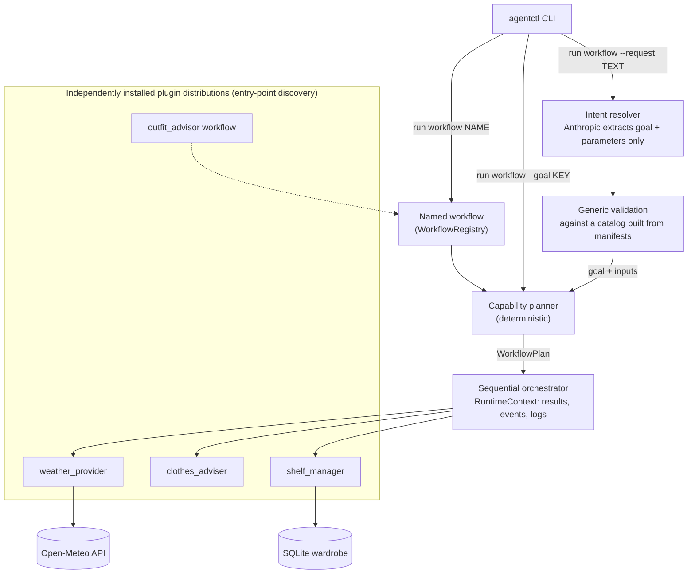

# Agentic Workflow Framework

A small Python framework for running workflows built from independently
installed agents. The core (`agentctl-core`) is generic: it discovers agent and
workflow plugins through Python entry points, plans which agents to run from
the inputs and outputs they declare, and runs them in order.

The demonstration application recommends an outfit. It uses three separately
packaged agents and one separately packaged named workflow:
- **Weather provider:** gets the current forecast from the Open-Meteo API.
- **Clothes adviser:** applies deterministic clothing rules.
- **Shelf manager:** picks matching items from a SQLite wardrobe.

You can run a workflow by name, or generate one from a goal (an output key)
using capability metadata. Natural-language requests (`--request`) are an
optional enhancement on top of that and need an Anthropic API key.

## Key features

| Area | What is implemented |
|---|---|
| SDK | `BaseAgent`, `AgentManifest`, `Capability(requires, produces)`, `WorkflowDefinition`, `WorkflowPlan`, `RuntimeContext` |
| Plugins | Agents and workflows ship as separate distributions in PEP 420 namespace packages (`agentctl_agents.*`, `agentctl_workflows.*`) |
| Discovery | Dynamic loading from the `agentctl.agents` and `agentctl.workflows` entry-point groups |
| Planning | Deterministic capability-dependency planning, or validation of a named workflow's declared order |
| Execution | Sequential orchestrator that passes each step's outputs to later steps and checks them against the manifest |
| Runtime context | Session and workflow IDs, inputs, results, per-run memory, lifecycle events, logging |
| CLI | `agentctl list agents`, `list workflows`, `run workflow NAME / --goal / --request` |
| Natural language | An Anthropic-backed intent resolver, driven by plugin metadata (`InputSpec`, `GoalSpec`) and checked by generic validation |
| Demo data | SQLite wardrobe with 19 seeded sample items |
| Quality | Offline unit, integration and CLI tests; GitHub Actions on Python 3.10–3.12 |

## Architecture



All three entry modes end in the same planner and the same orchestrator.
- **Named workflow:** the planner checks the workflow's declared step order.
- **`--goal`:** the planner works backwards from the requested output key
  through each capability's `requires` and `produces`, which gives
  `weather.forecast → clothes.advise → shelf.match` for `outfit`. This order is
  not hardcoded.
- **`--request`:** the language model only picks a goal and extracts parameter
  values from a catalog built from plugin metadata. It does not see or choose
  agents, generate steps, or execute tools. Its answer is validated before
  normal planning starts.
- **Generic core:** the framework contains no weather, clothing or wardrobe
  logic.

Details: [docs/ARCHITECTURE.md](docs/ARCHITECTURE.md).

## Quick start

Requires Python 3.10 or newer, pip and Git. Live weather lookups need internet
access; an Anthropic key is not needed for this setup.

```bash
git clone https://github.com/IshaaS/agentic-workflow-framework.git
cd agentic-workflow-framework
python3 -m venv .venv
source .venv/bin/activate                         # Windows: .venv\Scripts\activate

# Install the core first, then the independent plugin distributions
python -m pip install --upgrade pip
python -m pip install -e './framework[dev]' \
  -e ./agents/weather-agent \
  -e ./agents/clothes-agent \
  -e ./agents/shelf-agent \
  -e ./workflows/outfit-workflow

# Create the demo wardrobe (19 sample items) and point the shelf agent at it
agentctl-shelf-init --db ./wardrobe.db --seed
export SHELF_DB_PATH=./wardrobe.db                # PowerShell: $env:SHELF_DB_PATH = ".\wardrobe.db"

# Check that the plugins were discovered
agentctl list agents
agentctl list workflows
```

The repository root is not a package, so install the five distributions as
shown rather than running `pip install -e .`.

## Running the framework

```bash
# List installed agents (with their manifests) and named workflows
agentctl list agents
agentctl list workflows

# Run the named workflow
agentctl run workflow outfit_advisor --input city=Dallas --input activity=theatre --input style=formal

# Generate the plan from capability metadata for the output key "outfit"
agentctl run workflow --goal outfit --input city=Chicago --input activity=office --input style=business_casual
```

- **Inputs:** `--input KEY=VALUE` can be repeated, and values are strings.
  `city` and `activity` are required.
- **Activities:** `outdoor_walk`, `theatre`, `casual` and `office`, plus the
  aliases `walk`, `walking`, `work` and `office_meeting`.
- **Style:** optional; `casual` (the default), `business_casual` or `formal`.

The result is printed to stdout as JSON, and logs go to stderr. Example from a
live run on 2026-10-11 (Chicago, clear, 20.3°C), condensed:

```json
{
  "top": {"id": 2, "name": "Navy polo", "clothing_type": "polo", "color": "navy"},
  "bottom": {"id": 10, "name": "Olive chinos", "clothing_type": "pants", "color": "olive"},
  "outerwear": null,
  "footwear": {"id": 19, "name": "Black dress shoes", "clothing_type": "dress_shoes", "color": "black"}
}
```

Recommendations change with the live weather and the wardrobe contents.
`outerwear` is `null` when no jacket is needed.

###  Natural-language requests

```bash
python -m pip install -e './framework[llm]'      # adds the Anthropic SDK
export ANTHROPIC_API_KEY=...                     # from a secure local source; never commit it
agentctl run workflow --request "What should I wear to the office in Chicago? I prefer business casual."
```

- **How it runs:** the request becomes `goal=outfit` plus `city`, `activity`
  and `style`. These are validated against the allowed values the plugins
  advertise, then go through the same planner and orchestrator as `--goal`.
- **Unsupported requests:** these are rejected before any agent runs (exit
  code 3).
- **Without a key:** `--request` exits with code 5 and prints the structured
  commands, which still work.

## Testing and CI

```bash
python -m pytest -q
```

- **Offline:** the tests never touch the network. A pytest fixture blocks
  sockets, Open-Meteo is replaced at the HTTP transport, the language model is
  replaced by scripted fakes, and each test that needs the wardrobe gets its
  own temporary seeded SQLite database.
- **End-to-end:** integration tests go through real entry-point discovery,
  planning (both generated and named) and orchestration of all three agents.
- **Extra:** without the `[llm]` extra, the Anthropic adapter tests
  are skipped.
- **CI:** [GitHub Actions](.github/workflows/ci.yml) runs on pushes and pull
  requests to `main` for Python 3.10, 3.11 and 3.12. It installs all five
  distributions plus the `[llm]` extra, smoke-tests `agentctl`, runs the
  integration and CLI tests, then runs the full suite. It needs no secrets.

Details, including manual live checks: [docs/TESTING.md](docs/TESTING.md).

## Documentation

| Document | Contents |
|---|---|
| [Architecture](docs/ARCHITECTURE.md) | SDK contracts, discovery, planning, orchestration, runtime context, errors and exit codes, natural-language flow |
| [Extending](docs/EXTENDING.md) | How to write, package, install and test a new agent or workflow plugin (with a non-clothing example) |
| [Testing](docs/TESTING.md) | Test layout, offline fakes, CI, manual live checks and recorded results |
| [Development](docs/DEVELOPMENT.md) | Requirements, sprint history, design decisions and trade-offs |
| [Limitations](docs/LIMITATIONS.md) | Current limitations, the clothing rules, and possible future work |
| [AI usage](docs/AI_USAGE.md) | Disclosure of AI-assisted development |
| [Sprint specifications](docs/sprints/) | The specification given to the coding assistant for each sprint |

Each package also has a short README:
[core](framework/README.md),
[weather](agents/weather-agent/README.md),
[clothes](agents/clothes-agent/README.md) and
[shelf](agents/shelf-agent/README.md).

## Limitations

This is a small prototype:
- **Execution:** sequential and single-goal, with no retries.
- **Plugins:** loading a plugin runs its code, so only trusted plugins should
  be installed.
- **Clothing advice:** a small fixed rule set.
- **Wardrobe:** one shared SQLite file of sample items, with no users or
  per-user inventory.
- **Natural language:** one-shot resolution of a single goal with string
  parameters.

See [docs/LIMITATIONS.md](docs/LIMITATIONS.md) for the full list and possible
enhancements.

## AI-assisted development

- **ChatGPT:** used for requirements analysis, architecture discussion,
  writing the sprint specifications, and reviewing implementation handoffs.
- **Claude Code** (VS Code extension, Claude Opus 5.5): generated the
  implementation, tests, CI configuration and documentation from those
  specifications, and ran the local tests and Git/GitHub operations.
- **The author:** made the scope and design decisions, ran the manual and live
  checks, and reviewed the implementations for each sprints, decided the changes and merged each pull request.

Full disclosure: [docs/AI_USAGE.md](docs/AI_USAGE.md).
