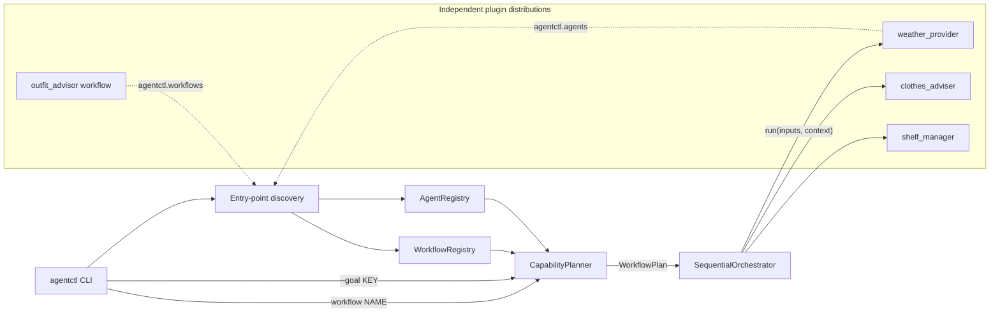

# Agentic Workflow Framework

A small Python framework for running workflows built from independently
installed agents. The core (`agentctl-core`) knows nothing about any
particular application. It discovers agent and workflow plugins through
Python entry points, plans which agents to run from their declared inputs
and outputs, and runs them one after another.

This repository also ships an example application: three agents and one
named workflow that together recommend an outfit.
- **Weather agent:** fetches a real forecast from Open-Meteo.
- **Clothes adviser:** applies deterministic clothing rules.
- **Shelf manager:** picks owned items from a SQLite wardrobe.

## Quick start

These are the CI install commands. Run them from the repository root in a
fresh virtual environment.

```bash
git clone https://github.com/IshaaS/agentic-workflow-framework.git
cd agentic-workflow-framework
python3 -m venv .venv && source .venv/bin/activate

python -m pip install --upgrade pip
python -m pip install -e './framework[dev]' \
  -e ./agents/weather-agent \
  -e ./agents/clothes-agent \
  -e ./agents/shelf-agent \
  -e ./workflows/outfit-workflow

agentctl-shelf-init --db ./wardrobe.db --seed     # create a demo wardrobe
export SHELF_DB_PATH=./wardrobe.db                # PowerShell: $env:SHELF_DB_PATH = ".\wardrobe.db"

agentctl list agents
agentctl list workflows
agentctl run workflow outfit_advisor --input city=Dallas --input activity=outdoor_walk
agentctl run workflow --goal outfit --input city=Dallas --input activity=outdoor_walk

python -m pytest -q
```

The repository root is a monorepo, not a package, so `pip install -e .` from
the root does not work. Install the five distributions as shown above.

**Prerequisites:**
- Python 3.10 or newer. CI runs 3.10, 3.11 and 3.12; it was also tested locally on 3.11 and 3.12.
- pip.
- Internet access, only for live weather lookups. The tests never use the network.

## Architecture



- **SDK** (`agentctl_core.sdk`, `context`): `BaseAgent`, `AgentManifest`,
  `Capability(name, requires, produces)`, `WorkflowDefinition`, `WorkflowPlan`,
  `RuntimeContext`.
- **Discovery and registries:** load agents from the `agentctl.agents` entry
  points and workflows from `agentctl.workflows`. Duplicate agent names or
  capability names are rejected.
- **Planner:** builds a `WorkflowPlan` either from a goal (an output key) or
  from a named workflow. Both kinds of plan look the same.
- **Orchestrator:** runs the plan's steps in order. It passes the inputs plus
  all earlier outputs to each agent, checks every agent's outputs against its
  manifest, and records lifecycle events.
- **CLI:** a thin adapter over the pieces above, built with `argparse`.

The core never imports a plugin. You can check this with
`grep -r agentctl_agents framework/src`, which finds nothing.

### Package layout

| Path | Distribution | Python package | Provides |
|---|---|---|---|
| `framework/` | `agentctl-core` | `agentctl_core` | SDK, discovery, registries, planner, orchestrator, `agentctl` CLI |
| `agents/weather-agent/` | `agentctl-weather-agent` | `agentctl_agents.weather` | `weather.forecast`: `city` → `weather` |
| `agents/clothes-agent/` | `agentctl-clothes-agent` | `agentctl_agents.clothes` | `clothes.advise`: `weather`, `activity` → `clothing_requirements` |
| `agents/shelf-agent/` | `agentctl-shelf-agent` | `agentctl_agents.shelf` | `shelf.match`: `clothing_requirements` → `outfit`; `agentctl-shelf-init` command |
| `workflows/outfit-workflow/` | `agentctl-outfit-workflow` | `agentctl_workflows.outfit` | Named workflow `outfit_advisor` |
| `tests/` | — | — | Unit, integration and CLI tests |
| `docs/` | — | — | Master plan and sprint specifications |

`agentctl_agents` and `agentctl_workflows` are PEP 420 namespace packages
shared by separate distributions, so neither has an `__init__.py`. Each
package has its own README with details.

## Usage

```text
agentctl list agents
agentctl list workflows
agentctl run workflow NAME   [--input KEY=VALUE ...]
agentctl run workflow --goal OUTPUT_KEY [--input KEY=VALUE ...]
```

**Two ways to run:**
- `run workflow NAME` runs a registered workflow in its declared order. The
  order is checked but never rearranged.
- `run workflow --goal KEY` generates a plan that produces the output key
  `KEY`. Note that `outfit` is an output key, while `outfit_advisor` is the
  name of the registered workflow.
- Give exactly one of `NAME` or `--goal`.

**Inputs:**
- `--input KEY=VALUE` can be repeated. It is split at the first `=`, and
  values are always strings.
- Giving the same key twice is an error.
- The outfit example needs `city` and `activity`. `activity` is one of
  `outdoor_walk`, `theatre` or `casual`.
- `style` is optional: `casual` (the default) or `formal`.

**The wardrobe database:** it is never created automatically. Run
`agentctl-shelf-init --db PATH [--seed]` once, then point `SHELF_DB_PATH` at
the file. Re-running with `--seed` won't duplicate or overwrite items.

### Example output

This is real output from a local run on 2026-10-11, with logs omitted. Live
weather changes, so your results will differ.

```console
$ agentctl list agents 2>/dev/null
clothes_adviser 0.1.0
  Recommends clothing types for the weather and activity
  capability: clothes.advise
    requires: weather, activity
    produces: clothing_requirements
shelf_manager 0.1.0
  Matches clothing requirements to items on the personal shelf
  capability: shelf.match
    requires: clothing_requirements
    produces: outfit
weather_provider 0.1.0
  Provides a weather forecast for a city
  capability: weather.forecast
    requires: city
    produces: weather

$ agentctl run workflow --goal outfit --input city=Dallas --input activity=theatre --input style=formal 2>/dev/null
{
  "top": {"id": 5, "name": "White dress shirt", "clothing_type": "dress_shirt", "color": "white"},
  "bottom": {"id": 10, "name": "Olive chinos", "clothing_type": "pants", "color": "olive"},
  "outerwear": {"id": 15, "name": "Navy blazer", "clothing_type": "blazer", "color": "navy"},
  "footwear": {"id": 19, "name": "Black dress shoes", "clothing_type": "dress_shoes", "color": "black"}
}

$ agentctl run workflow --goal outfit --input activity=theatre
agentctl: error: missing required input 'city' (required by 'weather.forecast'); pass it with --input city=VALUE
$ echo $?
3
```

In the theatre run, the demo dress pants are marked unavailable, so the shelf
falls back to the adviser's second choice, `pants`. The real output prints
each item across several lines; it's condensed here.

## How plans are chosen

No LLM is involved. Planning is deterministic and uses only the manifests of
the installed agents.

**From a goal** (`--goal KEY`), the planner works backwards:
- It finds the single capability that produces `KEY`.
- It then resolves each of that capability's `requires` the same way, unless
  the key was supplied with `--input`.
- Each capability is placed after the capabilities it depends on. A
  capability that several others depend on is planned only once.
- It refuses to plan when it finds a cycle, or two capabilities producing the
  same key.

For `--goal outfit` this produces `weather.forecast → clothes.advise →
shelf.match`. That order comes from the dependencies; it is not hardcoded.

**From a named workflow** (`NAME`):
- The workflow is a separately installed plugin that lists capability IDs in
  order.
- The planner checks that every step is installed and that each step's
  inputs are available, either from `--input` or from an earlier step. It
  never reorders steps.

**Missing user input vs. a missing agent.** The planner needs to tell a
missing user input apart from a missing agent. Plugins don't label which keys
users must supply, so the CLI treats a key as a user input if no installed
capability produces it, or if the user passed it. For example, a run without
`city` is reported as a missing input, while uninstalling the clothes agent
would be reported as a missing capability.

## Observability and errors

- **stdout:** only the JSON result.
- **stderr:** logs and errors.
- **Logging setup:** the CLI sets up logging to stderr only while a command
  runs. Importing the library never configures logging handlers.
- **Log lines:** every lifecycle message carries the workflow ID, session ID,
  step number, capability, agent and duration.
- **Events:** each run records structured events in `RuntimeContext.events`:
  `workflow_started`, `agent_started`, `agent_completed`, `agent_failed`,
  `workflow_completed` and `workflow_failed`.
- **Fail fast:** the first failing step stops the workflow, and no partial or
  invented result is printed.

| Exit code | Meaning |
|---:|---|
| 0 | Success |
| 2 | Invalid command line or `--input` |
| 3 | Planning failed (missing input, unknown goal or workflow, invalid plan); nothing ran |
| 4 | A step failed (e.g. weather API error or missing wardrobe); names the failed step |
| 5 | A plugin could not be loaded |

## Testing

```bash
python -m pytest -q
```

The suite has 294 tests. It covers the SDK, registries, discovery, each
agent, the planner, the orchestrator and the CLI. The end-to-end path is in
`tests/test_workflow_integration.py` and `tests/test_cli.py`:
- Plugins are discovered from installed entry points.
- A plan is generated or loaded, then run by the orchestrator.
- The output must contain real items from a temporary seeded SQLite
  database.
- Weather HTTP is replaced at the transport level by a fake.
- A test fixture blocks all network access, so a test that tries to reach the
  internet fails.

**CI:** `.github/workflows/ci.yml` runs on pushes and pull requests to `main`
for Python 3.10, 3.11 and 3.12. It installs all five distributions, smoke-tests
the `agentctl` command, runs the integration and CLI tests by name, and then
runs the full suite. It needs no secrets or services.

## Assumptions and limitations

**Planning:**
- One capability per output key; competing providers are rejected, not
  ranked.
- One goal per run.
- The planner is deterministic dependency resolution, not natural-language
  understanding or optimisation.
- CLI inputs are strings and are passed to agents as-is.

**Execution:**
- Workflows are sequential only: no branching, loops, parallel steps or
  retries.
- Memory and events last for one run; there is no persistent session or chat.

**Weather agent:**
- It uses the first geocoding match for a city name.
- It reads the current local hour only.
- It has a 10-second timeout and does not retry.
- Open-Meteo's free tier is for non-commercial use.

**Clothes and wardrobe:**
- The clothing rules are a small fixed rule set.
- The demo wardrobe is sample data.

**Plugins:**
- Loading a plugin runs its code, so only install plugins you trust.
- If a plugin is installed without `agentctl-core` already present, pip may
  try to fetch `agentctl-core` from PyPI, which is not this project. Install
  `./framework` first.

**Logging:**
- The weather agent logs the resolved city name at INFO level.

## Writing a plugin

An agent is a separately installable distribution with no changes to the
core:

```python
# src/my_agents/greeter/agent.py
from agentctl_core import AgentManifest, BaseAgent, Capability

class GreeterAgent(BaseAgent):
    @property
    def manifest(self):
        return AgentManifest(
            name="greeter", version="0.1.0", description="Greets someone",
            capabilities=[Capability("greet.say", requires=["name"], produces=["greeting"])],
        )

    def run(self, inputs, context):
        context.logger.info("Greeting someone")
        return {"greeting": f"Hello, {inputs['name']}!"}
```

```toml
# pyproject.toml
[project]
name = "my-greeter-agent"
version = "0.1.0"
dependencies = ["agentctl-core>=0.1.0"]

[project.entry-points."agentctl.agents"]
greeter = "my_agents.greeter.agent:GreeterAgent"

[tool.setuptools.packages.find]
where = ["src"]
namespaces = true    # my_agents/ has no __init__.py if shared by several distributions
```

**Requirements for an agent:**
- The class must be constructible with no arguments.
- `run` must return exactly the keys listed in `produces`.

After installing it, `agentctl run workflow --goal greeting --input name=Ada`
works. A workflow plugin works the same way: register a zero-argument
function returning a `WorkflowDefinition` under
`[project.entry-points."agentctl.workflows"]`.

## Generative AI use disclosure

> **Author: complete every `TODO` item below before submission.** The
> statements that aren't marked `TODO` are facts recorded during
> implementation; please check them too.

**Coding assistant used for implementation:**
- **Tool:** Claude Code (Anthropic), running as the Claude Code extension in
  Visual Studio Code.
- **Model:** Claude Opus 5.5 (model ID `claude-opus-5-5`).
- **Permission mode:** auto mode was on during the implementation session.
- **Plugins:** a third-party skills plugin ("superpowers") was installed.
  Its skills were available but were not invoked for this work.
- **Shell access:** Claude Code ran commands in the local shell, including
  pip, pytest, git and `gh`.

**How it was used, sprint by sprint:**
- **Inputs:** for each sprint, the author gave Claude Code a short prompt and
  the matching specification in `docs/sprints/`. The master plan,
  `docs/AGENTIC_WORKFLOW_FRAMEWORK_MASTER_PLAN.md`, was provided as context.
- **What Claude Code did:**
  - inspected the existing code;
  - wrote the implementation, tests and package READMEs for that sprint;
  - ran the test suite in a local virtual environment (Python 3.11);
  - ran clean non-editable installs in fresh Python 3.12 environments;
  - deliberately broke code to confirm the tests catch real bugs;
  - ran manual live weather and CLI checks;
  - committed the work with a `Co-Authored-By: Claude` trailer;
  - wrote a handoff report.
- **What it produced:** all source code under `framework/`, `agents/`,
  `workflows/` and `tests/`, plus this README and the CI workflow, was
  generated by Claude Code from those specifications.
- **Merging:** the author merged each sprint into `main` through GitHub pull
  requests (#1–#3 at the time of writing), and committed the sprint
  specification documents separately.

**Planning and specifications:**
- `TODO`: Who wrote the master plan and the sprint specifications, and with
  which tools or models (if any)? For example, which assistant helped with
  architecture discussion and sprint scoping?

**Human review and verification:**
- `TODO`: Which code did you read and review? Which commands did you run
  yourself (tests, CLI runs, clean installs)? Which design decisions did you
  make or change? Which bugs did you find or fix?
- `TODO`: Approximate time spent, and anything you would explain differently
  in a review.

**Known limitations of the AI-assisted process:**
- The assistant's own test runs and checks are recorded in each sprint's
  handoff report.
- Python 3.10 was never available locally; it is verified only in CI.
